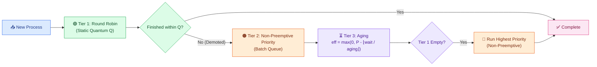

<div align="center">

# ⚙️ Cloud-Cluster CPU Scheduler Simulator

<br/>


-22c55e?style=for-the-badge)


**A Java simulator for mixed cloud-cluster workloads featuring an Adaptive Container Scheduler (ACS) and Preemptive Shortest-Job First (SJF) with full Context-Switch modeling, Gantt charts, and step-by-step traces.**

[Features](#-features) · [How it works](#-how-it-works) · [Usage](#-usage) · [Example](#-example) · [Project Structure](#-project-structure) · [Notes](#-notes-and-design-details) · [Team](#-team)

</div>

---

## ✨ Features

| | |
|---|---|
| 🔀 **Adaptive Container Scheduler (ACS)** | Multi-tier feedback scheduler balancing latency-sensitive interactive tasks and CPU-heavy batch jobs |
| ⚡ **Preemptive SJF** | Shortest Remaining Time First scheduling with tie-breaking in favor of the currently running process |
| ⏱️ **Context Switch (CS) Modeling** | Accurately accounts for configurable context-switch overhead on every process switch |
| ⏳ **Starvation Prevention (Aging)** | Dynamically boosts effective priority of waiting Tier 2 batch jobs over time |
| 🖥️ **Interactive Swing GUI** | Live process editor, built-in presets, custom Gantt timeline, metrics table, and step-by-step trace |
| 💻 **CLI Mode** | Run built-in benchmark test cases directly in the terminal for quick verification |
| 📊 **Complete Metrics** | Calculates per-process and average Waiting Time, Turnaround Time, and Response Time |

---

## ⚙️ How it works



### Adaptive Container Scheduler (ACS)
1. **Tier 1 (Initial Interactive Queue):** Every arriving process enters a FIFO Round Robin queue with a static time quantum `Q`.
2. **Tier 2 (Demotion to Batch Queue):** If a process consumes its full quantum `Q` without finishing, it is classified as CPU-bound and demoted to a Non-Preemptive Priority queue (lower numerical value = higher priority). Once a Tier 2 process starts executing, it runs to completion without preemption.
3. **Tier 3 (Aging Mechanism):** Whenever Tier 1 is empty and the CPU selects from Tier 2, each waiting process's effective priority is boosted based on how long it has waited in Tier 2:
   $$\text{Effective Priority} = \max\left(0,\ \text{Initial Priority} - \left\lfloor \frac{t - t_{\text{demoted}}}{\text{Aging Interval}} \right\rfloor\right)$$
4. **Smart Context Switching:** Context-switch overhead (`CS`) is incurred only when switching between two *different* processes. If a process moves from Tier 1 to Tier 2 and immediately continues running because no other process is ahead of it, `CS = 0`.

### Preemptive SJF (SRTF)
- Evaluates the ready queue at every time unit and always runs the process with the smallest `remaining` burst time, preserving the currently running process on ties to avoid unnecessary context switches.

<details>
<summary><b>🔍 Simulation & Tie-Breaking Details</b></summary>

<br/>

- **Input Independence:** `Proc.sortedCopies()` deep-copies and sorts processes by arrival time before every run, ensuring repeated simulations never mutate original inputs.
- **Tier Precedence:** Tier 1 strictly takes precedence over Tier 2 when the CPU is idle and choosing the next job, though an already-running Tier 2 job is never preempted by newly arriving Tier 1 jobs.
- **Priority Scale:** Lower integers represent higher scheduling priority (`0` is the highest possible aged priority).

</details>

---

## 🚀 Usage

Compile all `.java` source files in the project directory:

```bash
javac *.java
```

### 🖥️ Launch GUI Mode (Default)

```bash
java SchedulerGUI
```

1. **Add / Edit Processes:** Add custom rows, remove rows, or load **Example 1** / **Example 2** with one click.
2. **Configure Settings:** Choose between **ACS** and **Preemptive SJF**, and adjust **Quantum (`Q`)**, **Context-switch time (`CS`)**, and **Aging interval**.
3. **Run Simulation:** Click **Run simulation** to inspect the color-coded **Gantt chart**, **Process Metrics table**, and **Step-by-step queue trace**.

### 💻 Launch CLI Mode

Run with the `cli` argument to print full step-by-step traces and metrics for built-in Test Cases 1 & 2 across both algorithms:

```bash
java SchedulerGUI cli
```

---

## 🧪 Example

**Test Case 2 Input** (`Q = 3`, `CS = 1`, `Aging = 4`):

| Process | Arrival Time | Burst Time | Initial Priority |
|:---:|:---:|:---:|:---:|
| `P1` | 0 | 5 | 4 |
| `P2` | 1 | 6 | 2 |
| `P3` | 4 | 4 | 3 |

**ACS Output Metrics:**

| Process | Arrival | Burst | Finish | Turnaround | Waiting | Response |
|:---:|:---:|:---:|:---:|:---:|:---:|:---:|
| `P1` | 0 | 5 | 18 | 18 | 13 | 0 |
| `P2` | 1 | 6 | 15 | 14 | 8 | 3 |
| `P3` | 4 | 4 | 20 | 16 | 12 | 4 |

- **Average Turnaround Time:** `16.00` time units
- **Average Waiting Time:** `11.00` time units
- **Average Response Time:** `2.33` time units

---

## 📦 Project Structure

| File | Responsibility |
|---|---|
| 📄 **`Proc.java`** | Process data model and metric formulas (`TAT`, `WT`, `RT`) with immutable copy helpers |
| 🔀 **`ACSScheduler.java`** | 3-tier Adaptive Container Scheduler engine with aging and context-switch tracking |
| ⚡ **`SJFScheduler.java`** | Preemptive Shortest-Job First (SRTF) engine with context-switch support |
| 📊 **`Result.java`** | Simulation trace storage, average metric aggregators, and formatted CLI printer |
| 🖥️ **`SchedulerGUI.java`** | Swing desktop interface, custom Gantt chart renderer, and CLI entry point |

---

## 📝 Notes and design details

> [!NOTE]
> The simulator uses pure Java Standard Library (`javax.swing` & `java.util`) with zero external dependencies, making it portable across Windows, Linux, and macOS.

- **Validation:** Burst times must be strictly greater than `0`, arrival times must be `>= 0`, and the aging interval must be `>= 1`.
- **Dynamic UI Controls:** Selecting **Preemptive SJF** in the GUI automatically disables `Quantum (Q)` and `Aging interval` spinners since they apply exclusively to ACS.
- **Metrics Definitions:**
  - $\text{Turnaround Time} = \text{Finish Time} - \text{Arrival Time}$
  - $\text{Waiting Time} = \text{Turnaround Time} - \text{Burst Time}$
  - $\text{Response Time} = \text{First CPU Execution Time} - \text{Arrival Time}$

---

## 👥 Team

<div align="center">

**CS241: Operating Systems - 1 · Faculty of Computers and Artificial Intelligence, Cairo University**

*Member 1 · Member 2 · Member 3 · Member 4*

</div>

---

<div align="center">

Built with ☕ Java & Swing for OS Scheduling Simulation

</div>